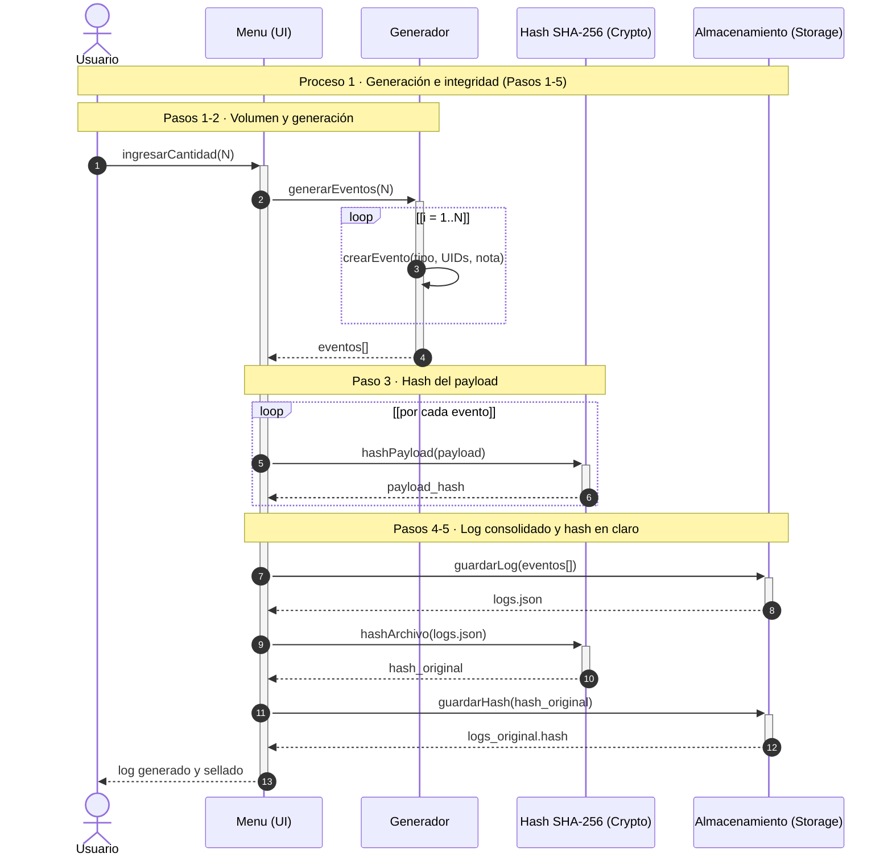
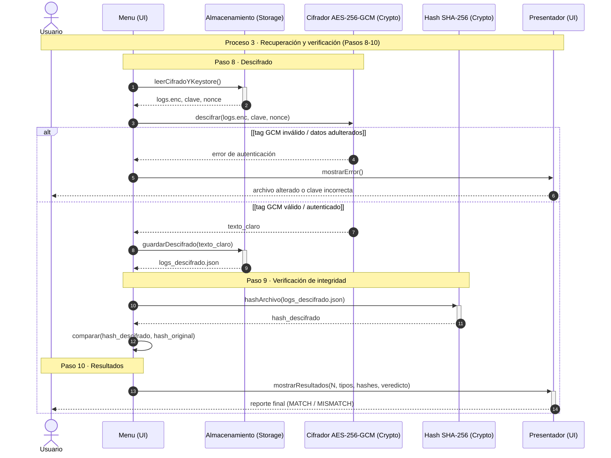

# Diagramas de Secuencia UML - Arquitectura del Sistema Criptográfico

> [!NOTE]
> **Fundamentación y Estándar de Modelado UML:**
> Los diagramas presentados a continuación modelan la interacción temporal y el intercambio de mensajes entre los componentes del sistema, siguiendo las convenciones del estándar UML documentadas en la guía de [Visual Paradigm - What is a Sequence Diagram?](https://www.visual-paradigm.com/guide/uml-unified-modeling-language/what-is-sequence-diagram/).
> 
> En cada diagrama se implementan los elementos clave de la notación:
> - **Líneas de vida (*Lifelines*):** Actores (`actor`) y componentes de software (`participant`) con su correspondiente eje temporal descendente.
> - **Focos de control y activación (*Execution occurrences / Activation bars*):** Delimitados mediante `->>+` (inicio de ejecución) y `-->>-` (retorno y liberación del foco).
> - **Fragmentos combinados (*Combined fragments*):** Bloques `loop` para procesamientos iterativos y `alt / else` para flujos condicionales alternativos (e.g., validación de integridad y autenticación criptográfica).
> - **Secuenciación temporal:** Numeración unívoca y cronológica de llamadas mediante `autonumber`.

---

## 1. Proceso 1: Generación de Datos e Integridad en Claro (Pasos 1 al 5)

**Propósito:** Orquestar la solicitud del volumen $N$, la simulación sintética de eventos de calificaciones académicas, el cálculo del hash individual SHA-256 por cada `payload` (evitando circularidad criptográfica) y la persistencia del log consolidado junto con su huella digital original.

---

## 2. Proceso 2: Protección y Cifrado en Reposo (Pasos 6 y 7)

**Propósito:** Proteger la confidencialidad de los datos en disco mediante cifrado simétrico autenticado **AES-256-GCM**. Se genera entropía criptográfica para la clave y el nonce, desacoplando el plano de datos (`logs.enc`) del plano de gestión de llaves (`keystore.json`) y sellando la huella del archivo cifrado (`logs_cifrado.hash`).

```mermaid
sequenceDiagram
    autonumber
    participant UI as Menu (UI)
    participant S as Almacenamiento (Storage)
    participant C as Cifrador AES-256-GCM (Crypto)
    participant H as Hash SHA-256 (Crypto)

    Note over UI,H: Proceso 2 · Protección en reposo (Pasos 6-7)

    Note over UI,C: Paso 6 · Cifrado
    UI->>+S: leerLog(logs.json)
    S-->>-UI: texto_claro
    UI->>+C: cifrar(texto_claro)
    C->>C: generarClaveYNonce()
    C-->>-UI: logs.enc, clave, nonce
    UI->>+S: guardarCifrado(logs.enc)
    S-->>-UI: ok
    UI->>+S: guardarKeystore(clave, nonce)
    S-->>-UI: keystore.json

    Note over UI,H: Paso 7 · Hash del log cifrado
    UI->>+H: hashArchivo(logs.enc)
    H-->>-UI: hash_cifrado
    UI->>+S: guardarHash(hash_cifrado)
    S-->>-UI: logs_cifrado.hash
```

---

## 3. Proceso 3: Recuperación, Verificación y Auditoría Final (Pasos 8 al 10)

**Propósito:** Recuperar el contenido original aplicando descifrado autenticado. Mediante un fragmento condicional alternativo (`alt / else`), se verifica la etiqueta GMAC: si los datos o la clave fueron adulterados, el proceso aborta; si son válidos, se calcula el hash del archivo descifrado y se compara bit a bit contra el hash original, presentando el veredicto al usuario.

