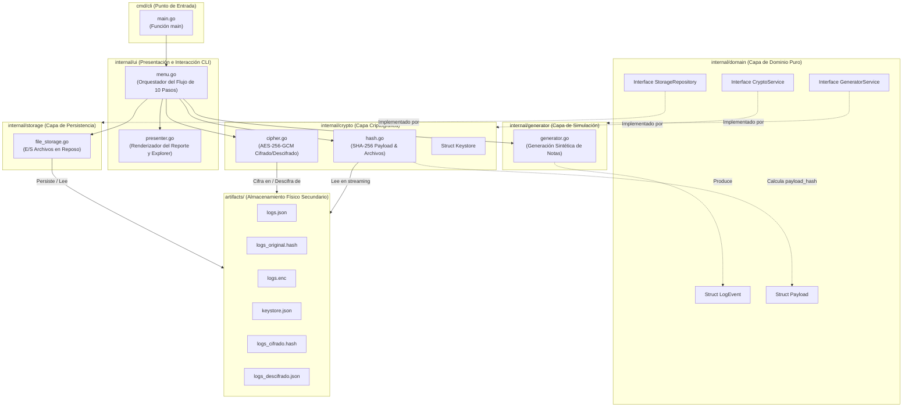
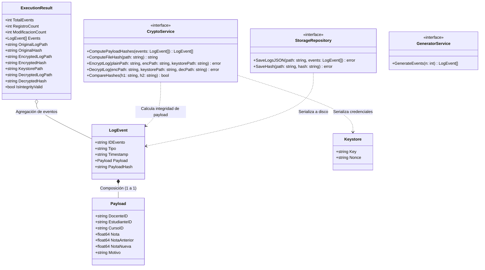
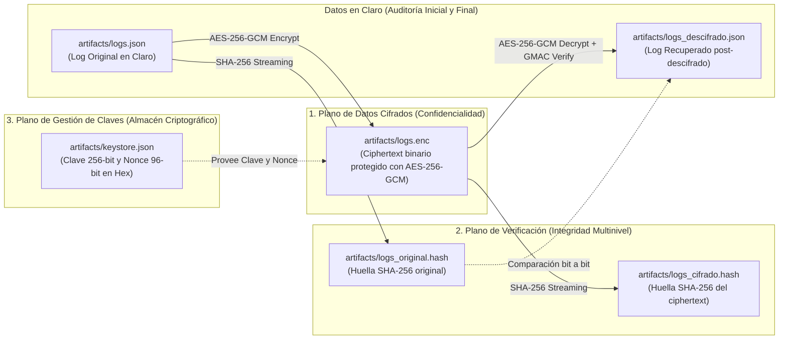
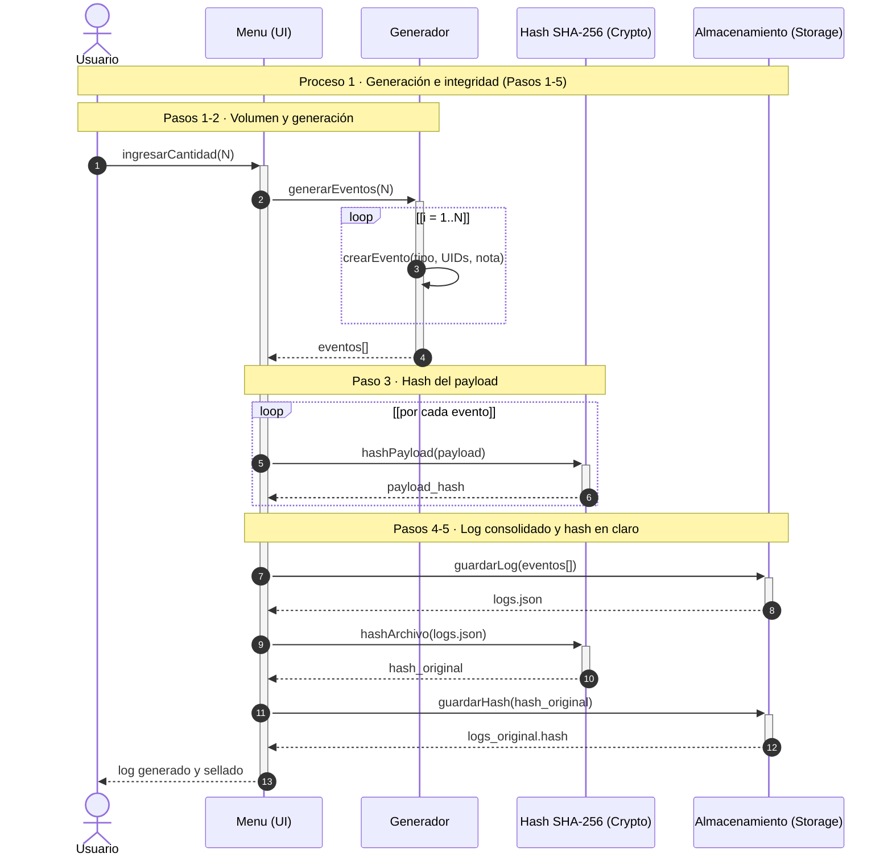
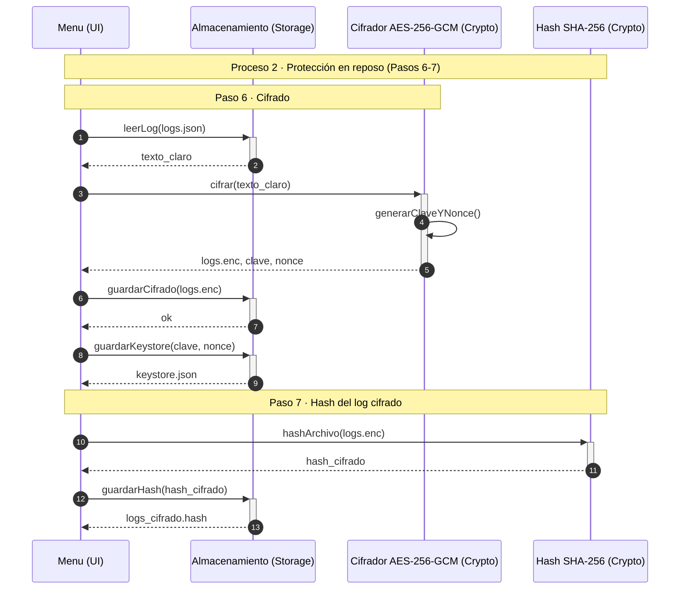
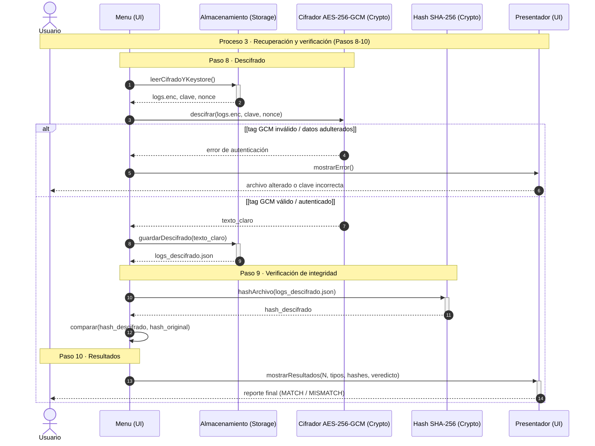

# Modelado UML: Diagramas de Estructura y Comportamiento

> [!NOTE]
> **Fundamentación y Estándar de Modelado UML:**
> Este documento consolida la arquitectura del sistema de protección criptográfica de logs en reposo según los estándares de modelado UML y los requerimientos del taller de la Universidad del Valle.
> 
> - **Diagramas de Estructura (Estáticos):** Modelan la organización de paquetes, componentes modulares, interfaces, estructuras de datos (`structs`) y la segregación de planos de seguridad en almacenamiento secundario.
> - **Diagramas de Comportamiento (Dinámicos):** Modelan la interacción temporal y el flujo secuencial de los 10 pasos operativos mediante líneas de vida (*lifelines*), focos de activación y fragmentos combinados (`loop`, `alt / else`).

---

# PARTE 1: DIAGRAMAS DE ESTRUCTURA (ARQUITECTURA ESTÁTICA)

## 1.1. Diagrama de Componentes y Paquetes (Package & Component Diagram)

**Propósito:** Ilustrar la descomposición modular del sistema siguiendo las directrices de Arquitectura Limpia (*Clean Architecture*) e Inversión de Dependencias. La capa de presentación (`ui`) orquesta las capas de `generator`, `crypto` y `storage`, mientras que la capa `domain` contiene los modelos e interfaces desacopladas.

---

## 1.2. Diagrama de Clases y Estructuras de Datos (Class & Struct Diagram)

**Propósito:** Modelar las estructuras de datos nativas en Go, los contratos de interfaz del dominio y las relaciones de composición y agregación entre los tipos del sistema.

---

## 1.3. Diagrama de Estructura de Seguridad: Aislamiento de Planos en Reposo

**Propósito:** Representar el desacoplamiento arquitectónico de los tres dominios de seguridad en almacenamiento secundario (`artifacts/`): plano de datos, plano de verificación (hashes) y plano de gestión de llaves criptográficas (simulando un KMS/HSM).

---

# PARTE 2: DIAGRAMAS DE COMPORTAMIENTO (SECUENCIA UML)

## 2.1. Proceso 1: Generación de Datos e Integridad en Claro (Pasos 1 al 5)

**Propósito:** Orquestar la solicitud del volumen $N$, la simulación sintética de eventos de calificaciones académicas, el cálculo del hash individual SHA-256 por cada `payload` (evitando circularidad criptográfica) y la persistencia del log consolidado junto con su huella digital original.

---

## 2.2. Proceso 2: Protección y Cifrado en Reposo (Pasos 6 y 7)

**Propósito:** Proteger la confidencialidad de los datos en disco mediante cifrado simétrico autenticado **AES-256-GCM**. Se genera entropía criptográfica para la clave y el nonce, desacoplando el plano de datos (`logs.enc`) del plano de gestión de llaves (`keystore.json`) y sellando la huella del archivo cifrado (`logs_cifrado.hash`).

---

## 2.3. Proceso 3: Recuperación, Verificación y Auditoría Final (Pasos 8 al 10)

**Propósito:** Recuperar el contenido original aplicando descifrado autenticado. Mediante un fragmento condicional alternativo (`alt / else`), se verifica la etiqueta GMAC: si los datos o la clave fueron adulterados, el proceso aborta; si son válidos, se calcula el hash del archivo descifrado y se compara bit a bit contra el hash original, presentando el veredicto al usuario.

